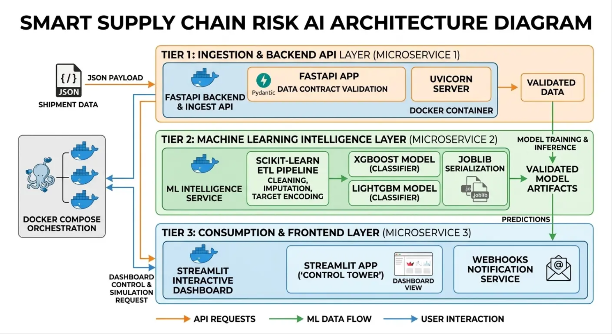

# Smart Supply Chain Risk AI

Torre de Control Inteligente de Logística y Cadena de Suministro B2B.

Sistema B2B de analítica predictiva para anticipar retrasos en envíos desde la
creación del pedido. Integra un modelo XGBoost, una API REST en FastAPI y un
dashboard en Streamlit. Este README es la guía de reproducibilidad de la
entrega: explica cómo levantar la aplicación, qué comandos están disponibles y
cómo está organizado el repositorio.

## Objetivo

Predecir el riesgo de retraso de un envío desde la creación del pedido para que
los ERP/WMS y los gestores de tráfico puedan actuar antes del despacho. La
predicción se expone mediante una API y un dashboard.

## Miembros

- Adrián Matemalas Manzanaro
- Raúl Romero Montoro
- Raúl Rincón Ortiz

## Requisitos previos

| Herramienta | Versión de referencia | Uso |
| --- | --- | --- |
| Git | 2.30 o superior | Clonar el repositorio y cambiar al *tag* de entrega. |
| Docker Desktop | 24.0 o superior, con Docker Compose v2.20 o superior | Opción recomendada para levantar la aplicación completa. |
| Python | 3.10 | Solo si se ejecuta sin Docker. La imagen Docker usa `python:3.10-slim`. |
| Acceso a Kaggle | Opcional | Solo para descargar el dataset y reentrenar. El dataset es público. |

Todos los comandos de esta guía se ejecutan desde la raíz del repositorio.
En Windows, sustituye `cp` por `Copy-Item` y la activación de PowerShell se
indica en cada caso. Las dependencias de Python están acotadas por rangos
compatibles en `environment/requirements*.txt`; la vía Docker fija Python 3.10
y es la referencia para reproducir la entrega.

## Reproducibilidad de la aplicación

El repositorio versiona el modelo de referencia (`delay_risk_xgb.json`) y su
metadata (`model_metadata.json`). Por eso la API puede predecir sin reentrenar y
sin descargar el dataset. Los datos crudos y el Parquet limpio no son necesarios
para servir la aplicación.

### Opción recomendada: Docker Compose

Desde un clon limpio:

```bash
git clone https://github.com/Hulkobain/Grupo7-TFM-PlanetaFP.git
cd Grupo7-TFM-PlanetaFP
git checkout v1.0.0-nf3   # tag de la entrega NF3 (o el tag vigente)
cp .env.example .env
docker compose up --build -d
docker compose ps
```

En Windows PowerShell, el paso de configuración es:

```powershell
Copy-Item .env.example .env
```

Qué hace Compose:

- Construye dos objetivos independientes del `Dockerfile` (`api` y `dashboard`)
  sobre `python:3.10-slim`.
- Monta `src/ml/artifacts/` en solo lectura dentro de la API, de modo que el
  artefacto versionado queda disponible en `/app/src/ml/artifacts`.
- Espera a que la API supere su *healthcheck* antes de iniciar el dashboard.
- Conecta el dashboard con la API mediante la red interna de Compose
  (`http://api:8000`).
- No copia `data/` ni `tests/` dentro de las imágenes.

Servicios disponibles:

| Servicio | URL |
| --- | --- |
| Dashboard Streamlit | <http://localhost:8501> |
| Documentación interactiva de la API (Swagger UI) | <http://localhost:8000/docs> |
| Healthcheck de la API | <http://localhost:8000/health> |

Operación habitual:

```bash
docker compose logs -f api          # ver logs de la API
docker compose logs -f dashboard    # ver logs del dashboard
docker compose down                 # detener y eliminar los contenedores
docker compose up --build -d        # reconstruir y volver a levantar
```

Los puertos del host se pueden cambiar en `.env` con `API_PORT` y
`DASHBOARD_PORT`. El directorio de artefactos montado se puede cambiar con
`MODEL_ARTIFACT_HOST_DIR`.

### Opción alternativa: entorno virtual local

```bash
python -m venv .venv
source .venv/bin/activate
python -m pip install --upgrade pip
python -m pip install -r environment/requirements.txt
```

En Windows PowerShell:

```powershell
python -m venv .venv
.venv\Scripts\Activate.ps1
python -m pip install --upgrade pip
python -m pip install -r environment\requirements.txt
```

`environment/requirements.txt` incluye las dependencias de API, ML, dashboard y
pruebas. Los ficheros `requirements-api.txt`, `requirements-dashboard.txt` y
`requirements-ml.txt` son subconjuntos por capa; para entrenar o comparar
modelos también se puede instalar únicamente `environment/requirements-ml.txt`.

Arranca la API en una terminal:

```bash
uvicorn src.api.main:app --reload
```

Y el dashboard en otra:

```bash
streamlit run src/dashboard/app.py
```

El dashboard usa por defecto `http://127.0.0.1:8000` para hablar con la API.
La API y Streamlit **no cargan `.env` automáticamente**; los valores por defecto
funcionan sin configuración. Si necesitas cambiar el webhook o las rutas,
exporta las variables en la terminal antes de arrancar:

```bash
set -a
. ./.env
set +a
```

En PowerShell puedes definirlas directamente, por ejemplo:
`$env:WEBHOOK_URL = "https://example.test/alerts"`.

### Variables de entorno

`.env` lo lee Docker Compose automáticamente. En ejecución local hay que
exportarlas en la terminal.

| Variable | Valor por defecto | Ámbito | Descripción |
| --- | --- | --- | --- |
| `MODEL_ARTIFACT_DIR` | `src/ml/artifacts` | API | Directorio que contiene `delay_risk_xgb.json` y `model_metadata.json`. En Compose se fija a `/app/src/ml/artifacts`. |
| `WEBHOOK_URL` | Vacío | API | URL de destino de las alertas preventivas. Si está vacía, no se envían webhooks. |
| `WEBHOOK_MAX_ATTEMPTS` | `3` | API | Número de intentos del webhook; debe ser un entero positivo. |
| `API_BASE_URL` | `http://127.0.0.1:8000` | Dashboard | URL de la API que consume el dashboard. En Compose se fija a `http://api:8000`. |
| `API_PORT` | `8000` | Docker Compose | Puerto del host publicado para la API. |
| `DASHBOARD_PORT` | `8501` | Docker Compose | Puerto del host publicado para el dashboard. |
| `MODEL_ARTIFACT_HOST_DIR` | `./src/ml/artifacts` | Docker Compose | Directorio del host que se monta en la API en solo lectura. |

### Verificación rápida

Comprueba la API:

```bash
curl http://localhost:8000/health
```

Respuesta esperada:

```json
{"status":"ok"}
```

Prueba una predicción con el contrato real:

```bash
curl -s -X POST http://localhost:8000/predict \
  -H 'Content-Type: application/json' \
  -d '{
    "order_date": "2026-10-16T10:30:00Z",
    "shipping_mode": "Standard Class",
    "customer_segment": "Consumer",
    "market": "Europe",
    "order_region": "Western Europe",
    "order_items": [
      {
        "product_category_id": 12,
        "product_price": 49.99,
        "order_item_quantity": 2,
        "order_item_discount": 5.0
      }
    ]
  }'
```

La respuesta incluye `delay_risk`, `delay_probability`, `threshold` e
`interpretation`. Un `422` indica que el payload no cumple el contrato; un `503`
indica que el artefacto del modelo no está disponible.

### Pruebas automatizadas

```bash
python -m pytest
python -m pytest tests/test_api.py::test_health_returns_ok
python -m pytest tests/test_pipeline.py
```

Las pruebas se ejecutan siempre desde la raíz del repositorio, porque importan
`src.api.*` como paquete. No hay `conftest.py` ni `pytest.ini`; pytest descubre
`tests/test_*.py`.

## Comandos disponibles

| Comando | Qué hace | Requisitos |
| --- | --- | --- |
| `python -m src.data.download [--output DIR] [--force]` | Descarga los tres CSV de DataCo desde Kaggle a `data/raw/`. | `environment/requirements-ml.txt` (`kagglehub`). |
| `python -m src.data.clean [--input CSV] [--output PARQUET] [--no-download]` | Limpia el CSV y genera el Parquet agregado por pedido. | Dependencias de ML. |
| `python -m src.ml.train [--config YAML] [--data PARQUET] [--raw-data CSV] [--output-dir DIR] [--no-download]` | Entrena XGBoost y guarda el modelo y su metadata. | Parquet limpio o `--raw-data`; dependencias de ML. |
| `python -m src.ml.compare [--config YAML] [--data PARQUET] [--output-dir DIR] [--report JSON]` | Compara XGBoost y LightGBM sobre el mismo *split* temporal y guarda el informe. | Parquet limpio; dependencias de ML. |
| `python -m pytest [RUTA]` | Ejecuta la batería de pruebas. | `environment/requirements.txt`. |
| `uvicorn src.api.main:app --reload` | Arranca la API en `http://127.0.0.1:8000`. | Dependencias de API. |
| `streamlit run src/dashboard/app.py` | Arranca el dashboard en `http://localhost:8501`. | Dependencias de dashboard. |
| `docker compose up --build -d` | Construye y levanta API y dashboard. | Docker Compose. |
| `docker compose ps` | Muestra el estado de los servicios. | Docker Compose. |
| `docker compose logs -f SERVICIO` | Sigue los logs de `api` o `dashboard`. | Docker Compose. |
| `docker compose down` | Detiene y elimina los contenedores. | Docker Compose. |

Cada módulo con interfaz de línea de comandos documenta sus opciones con
`--help`, por ejemplo:

```bash
python -m src.data.download --help
python -m src.data.clean --help
python -m src.ml.train --help
python -m src.ml.compare --help
```

### Flujo de datos y entrenamiento

El código de entrenamiento vive en `src/ml`, separado de la API y del panel
porque tiene un ciclo de vida distinto (entrenamiento *offline* por lotes, no
desplegable). La imagen de API instala solo las dependencias de servicio e
inferencia; no incluye las herramientas de entrenamiento ni de descarga de
datos.

`src/data` limpia y agrega el CSV de DataCo a nivel de pedido. `src/ml` carga el
fichero resultante, entrena y guarda el artefacto.

Flujo completo desde cero:

```bash
python -m pip install -r environment/requirements-ml.txt
python -m src.data.download
python -m src.data.clean
python -m src.ml.train
```

`python -m src.data.clean` y `python -m src.ml.train --raw-data ...` descargan
automáticamente los CSV que falten antes de limpiar; añade `--no-download` para
desactivar esa descarga. Para limpiar y entrenar en un solo paso:

```bash
python -m src.ml.train --raw-data data/raw/DataCoSupplyChainDataset.csv
```

Para entrenar directamente desde un Parquet ya limpio:

```bash
python -m src.ml.train --data data/cleaned/orders.parquet
```

Sin `--data`, el entrenamiento usa la ruta de `data.cleaned_path` en
`src/ml/config.yaml` (`data/cleaned/orders.parquet` por defecto). Para comparar
con LightGBM:

```bash
python -m src.ml.compare
```

**Contrato de entrada del entrenamiento:** un fichero Parquet a nivel de pedido
con una columna por *feature* (incluido `order_timestamp`, segundos Unix para
ordenar temporalmente) y la columna `Late_delivery_risk` (0/1). Su ruta se
define en `config.yaml` (`data.cleaned_path`).

La limpieza valida la etiqueta y los atributos compartidos por pedido, agrega
las líneas a una fila por `Order Id` y guarda el Parquet definido en
`src/ml/config.yaml`. Solo conserva señales disponibles al crear el pedido:
timestamp y componentes derivados de la fecha, modo de envío, segmento, mercado,
región y agregados de sus artículos. Excluye identificadores, datos personales y
variables posteriores al envío. La entrada y la salida se pueden cambiar con
`--input` y `--output`.

El entrenamiento ordena los pedidos cronológicamente y reserva los segmentos
más recientes para validación (`validation_size`, 0.2) y prueba final
(`test_size`, 0.2), ambos configurables en `config.yaml`. Solo el segmento de
validación se usa para *early stopping*; las métricas se calculan una vez sobre
el segmento de prueba, que no participa en el entrenamiento.

Si ya existe un Parquet generado con una versión anterior de la limpieza,
regénéralo con `python -m src.data.clean` antes de entrenar para incluir
`order_timestamp`.

### Modelo y artefactos

El modelo principal es `XGBClassifier` con `objective: binary:logistic`, que
produce `P(retraso) ∈ [0,1]`. `/predict` expone esa probabilidad como
`delay_probability`; el porcentaje de riesgo es `100 × P` y `delay_risk` se
deriva con el umbral `model.threshold` (0.5 por defecto). LightGBM se mantiene
como modelo alternativo de comparación, no como artefacto desplegado.

`src.data.clean.build_shipment_features` aplica la misma agregación y
codificación al payload de un pedido, alineando las columnas con la lista de
*features* del artefacto. Las categorías no vistas se rellenan con cero; si un
grupo categórico queda vacío, se asigna la primera categoría conocida para dar
cobertura. La API carga el modelo nativo de XGBoost y su metadata al arrancar;
`MODEL_ARTIFACT_DIR` permite cambiar el directorio.

Los artefactos se guardan en `src/ml/artifacts/`:

- `delay_risk_xgb.json` (versionado): modelo en formato nativo de XGBoost,
  portable entre versiones. Se carga con
  `xgb.XGBClassifier().load_model(...)`.
- `model_metadata.json` (versionado): *features*, métricas, umbral, parámetros y
  nombres de los ficheros del modelo.
- `delay_risk_xgb.joblib` (local, ignorado por git): el `XGBClassifier` completo
  serializado con joblib, listo para usar desde Python/sklearn con
  `joblib.load(...)`. La API no lo necesita.
- `model_comparison.json` (local, ignorado por git): informe de comparación
  XGBoost/LightGBM.

FastAPI carga `delay_risk_xgb.json` y `model_metadata.json` desde ese directorio.
Si falta alguno, la API puede arrancar y `/health` sigue comprobando el servicio,
pero `/ingest` y `/predict` responden `503` hasta disponer de ambos. Docker monta
`src/ml/artifacts/` en solo lectura y el artefacto versionado ya está en esa
ruta, así que `docker compose up --build` predice sin pasos previos.

Para reentrenar, ejecuta `python -m src.ml.train` y commitea el nuevo
`delay_risk_xgb.json` junto con su `model_metadata.json`;
`tests/test_committed_artifact.py` falla si el artefacto deja de coincidir con
las *features* de `src/data/clean.py`. Para probar otro modelo sin tocar el repo,
apunta `MODEL_ARTIFACT_HOST_DIR` a otra carpeta con ambos ficheros.

### Comparación con LightGBM

`src/ml/compare.py` entrena un `LGBMClassifier` alternativo y lo compara con
XGBoost sobre el mismo *split* temporal, el mismo `seed` y una capacidad
equivalente (`max_depth: 6` / `num_leaves: 63`, mismo presupuesto de árboles,
`learning_rate`, `subsample`, `colsample_bytree` y `reg_lambda`). Ambos usan
solo el segmento de validación para *early stopping* y se evalúan una única vez
sobre el segmento de prueba.

El comando guarda `src/ml/artifacts/model_comparison.json` con las métricas de
cada modelo, sus hiperparámetros, el tiempo de entrenamiento/predicción y un
veredicto. La decisión se configura en `config.yaml`:

- `comparison.primary_metric` (`roc_auc` por defecto).
- `comparison.min_improvement`: margen mínimo que debe superar LightGBM para
  reemplazar a XGBoost (0.005 por defecto). Así se evita cambiar de modelo por
  diferencias que puedan ser ruido.

El campeón es XGBoost y el retador LightGBM. Se mantiene XGBoost salvo que
LightGBM mejore la métrica principal al menos en `min_improvement`; el campo
`verdict.reason` del informe deja constancia de la comparación y del tiempo de
entrenamiento de cada alternativa.

## Estructura del repositorio

```text
Grupo7-TFM-PlanetaFP/
├── .dockerignore
├── .env.example
├── .gitignore
├── Dockerfile
├── README.md
├── docker-compose.yml
├── data/
│   ├── raw/                       # CSV de Kaggle (ignorado por git)
│   └── cleaned/                   # Parquet generado (ignorado por git)
├── docs/
│   ├── ACUERDO_DE_TRABAJO.md
│   ├── Fase0_Presentacion_alineacion_viabilidad_Grupo7.pdf
│   ├── Fase1_Grupo7.pdf
│   ├── Fase2_Grupo7.pdf
│   └── arquitectura.png
├── environment/
│   ├── requirements.txt
│   ├── requirements-api.txt
│   ├── requirements-dashboard.txt
│   └── requirements-ml.txt
├── src/
│   ├── __init__.py
│   ├── api/
│   │   ├── __init__.py
│   │   ├── inference.py
│   │   ├── main.py
│   │   ├── schemas.py
│   │   └── webhooks.py
│   ├── dashboard/
│   │   ├── api_client.py
│   │   ├── app.py
│   │   └── filters.py
│   ├── data/
│   │   ├── __init__.py
│   │   ├── clean.py
│   │   └── download.py
│   └── ml/
│       ├── __init__.py
│       ├── artifacts/
│       │   ├── delay_risk_xgb.json       # versionado
│       │   └── model_metadata.json       # versionado
│       ├── compare.py
│       ├── config.py
│       ├── config.yaml
│       ├── evaluate.py
│       ├── model.py
│       ├── pipeline.py
│       └── train.py
└── tests/
    ├── test_api.py
    ├── test_committed_artifact.py
    ├── test_compare.py
    ├── test_dashboard_api.py
    ├── test_dashboard_filters.py
    ├── test_data_cleaning.py
    ├── test_data_download.py
    ├── test_evaluate.py
    ├── test_inference.py
    ├── test_pipeline.py
    └── test_webhooks.py
```

Los directorios ignorados conservan sus `.gitkeep`. También se ignoran `.env`,
`.venv/`, `__pycache__/`, `.pytest_cache/`, los CSV de `data/raw/`, el Parquet
de `data/cleaned/` y los artefactos locales del modelo
(`delay_risk_xgb.joblib` y `model_comparison.json`).

El repositorio se organiza así:

- `docs/`: entregables y documentación.
- `data/`: datos del proyecto, separados en `raw/` (crudos) y `cleaned/`
  (limpios, generados); ambos directorios se ignoran por git.
- `environment/`: configuración para reproducir el entorno.
- `src/api/`: API FastAPI, esquemas Pydantic, inferencia y webhooks.
- `src/dashboard/`: dashboard Streamlit, cliente HTTP y filtros.
- `src/data/`: descarga y limpieza del dataset.
- `src/ml/`: entrenamiento, evaluación, comparación y artefactos del modelo.
- `tests/`: pruebas automatizadas.

## Arquitectura



La aplicación se divide en tres capas:

- **Ingesta y servicio**: API FastAPI sobre Uvicorn. Recibe JSON, valida con
  Pydantic y carga el modelo en el ciclo de vida (`lifespan`) de la aplicación.
- **Inteligencia predictiva**: modelo XGBoost en formato nativo y transformación
  de *features* en memoria, sin I/O a disco durante las peticiones.
- **Consumo**: dashboard Streamlit que consulta la API y formulario de
  simulación de pedidos.

## API de ingesta y predicción

| Endpoint | Método | Descripción |
| --- | --- | --- |
| `/health` | `GET` | Comprueba que el servicio está vivo. No requiere el modelo. |
| `/ingest` | `POST` | Valida un envío, ejecuta la misma transformación de *features* que el modelo y devuelve el envío validado junto con la predicción. No persiste registros. |
| `/predict` | `POST` | Valida el mismo contrato y devuelve la predicción del modelo. No persiste registros. |

Ambos endpoints de inferencia responden `503 Service Unavailable` si el
artefacto no está configurado; no generan predicciones simuladas. Un payload
inválido responde `422` antes de comprobar la disponibilidad del modelo.

La respuesta indica `delay_risk` como aviso preventivo cuando la probabilidad
alcanza el umbral configurado (0.5 en el artefacto de referencia); no confirma
que el pedido vaya a retrasarse. También devuelve la probabilidad y el umbral
aplicado. El equipo revisará el equilibrio entre falsas alarmas y retrasos no
detectados antes de cambiarlo.

Ejemplo de respuesta:

```json
{
  "delay_risk": false,
  "delay_probability": 0.3477,
  "threshold": 0.5,
  "interpretation": "Aviso preventivo, no confirmación de que el pedido vaya a retrasarse."
}
```

### Contrato frente a DataCo

El dataset se obtiene de
[DataCo SMART SUPPLY CHAIN FOR BIG DATA ANALYSIS](https://www.kaggle.com/datasets/shashwatwork/dataco-smart-supply-chain-for-big-data-analysis)
(licencia CC0 1.0). La API se ha contrastado con
`DataCoSupplyChainDataset.csv` (53 columnas, 180.519 filas y 65.752 pedidos
distintos). Cada fila representa un artículo de pedido; los pedidos tienen entre
uno y cinco artículos en este dataset. Por eso, la API recibe atributos comunes
del pedido y una lista `order_items`. El CSV no se incluye en el repositorio.

| Campo de API | Columna de DataCo |
| --- | --- |
| `order_date` | `order date (DateOrders)`; la API requiere fecha ISO 8601 |
| `shipping_mode` | `Shipping Mode` |
| `customer_segment` | `Customer Segment` |
| `market` | `Market` |
| `order_region` | `Order Region` |
| `order_items[].product_category_id` | `Product Category Id` |
| `order_items[].product_price` | `Order Item Product Price` |
| `order_items[].order_item_quantity` | `Order Item Quantity` |
| `order_items[].order_item_discount` | `Order Item Discount` |

El contrato contiene solo atributos disponibles al crear el pedido y excluye
identificadores personales y variables de resultado que podrían causar fuga de
información. La API transforma estos campos al mismo conjunto de *features* del
modelo antes de ejecutar la inferencia. Los esquemas usan `extra="forbid"` y
límites numéricos estrictos, por lo que los campos inesperados o inválidos
responden `422` por diseño.

La etiqueta objetivo es `Late_delivery_risk`, pero no se acepta como dato de
entrada. También se excluyen del contrato las variables posteriores al envío
(por ejemplo, `Days for shipping (real)`, `Delivery Status` y
`shipping date (DateOrders)`), además de datos personales y vinculables como
`Customer Email`, `Customer Fname`, `Customer Lname`, `Customer Password`,
`Customer Street`, `Customer Zipcode`, `Customer Id` y `Order Customer Id`.
El CSV crudo no se debe subir al repositorio; su ruta local está protegida en
`.gitignore`. En DataCo las filas de un mismo pedido comparten la etiqueta
`Late_delivery_risk`; el modelo actual entrena y predice a nivel de pedido.

### Alertas por webhook

Cuando una predicción activa `delay_risk` (probabilidad igual o superior al
umbral del modelo), tanto `/ingest` como `/predict` envían una notificación HTTP
POST a `WEBHOOK_URL`, si está configurada. El payload incluye el evento
`shipment.delay_risk.preventive_alert`, los datos validados del pedido y la
probabilidad, umbral e interpretación preventiva de la predicción; no incluye
identificadores ni datos personales. El aviso es preventivo, no una confirmación
de retraso.

`WEBHOOK_MAX_ATTEMPTS` configura los intentos (por defecto, 3). Se reintentan
fallos de transporte y respuestas HTTP 408, 429 y 5xx, con espera exponencial y
timeout de 5 segundos por intento. Otros errores HTTP se registran sin reintento.
Si el destino falla después de los reintentos, se registra el error y la API
conserva la respuesta de inferencia. Sin `WEBHOOK_URL`, las predicciones se
devuelven normalmente y no se envía ninguna alerta. El envío usa I/O asíncrona,
pero se completa antes de responder, por lo que los reintentos pueden aumentar
la latencia de esa petición.

En Docker Compose, `WEBHOOK_URL` y `WEBHOOK_MAX_ATTEMPTS` se leen de `.env` y se
pasan al contenedor de la API. En local, expórtalas en la terminal.

## Dashboard

El dashboard comprueba la disponibilidad de la API y muestra:

- Filtros laterales por rango de fechas, nivel de riesgo y región.
- Indicadores operativos, mapa y gráfico de riesgo por región sobre un conjunto
  de envíos de ejemplo.
- Un formulario de simulación que envía un pedido real a `/predict` y muestra
  la probabilidad, el umbral y el nivel de riesgo devueltos por la API.
- Una tabla de envíos recientes de ejemplo, afectada por los filtros.

El dashboard todavía no consulta un histórico real ni agregados de la API; los
indicadores, el mapa, el gráfico y la tabla usan datos de demostración. El
formulario sí ejecuta inferencia real contra la API.

## Flujo de trabajo

El equipo trabaja con GitFlow: las tareas se desarrollan en ramas
`feature/<tarea>`, se revisan mediante PR hacia `develop` y las entregas se
integran en `main` con su correspondiente *tag*. `main` solo recibe versiones
preparadas para entrega. El acuerdo completo está en
[`docs/ACUERDO_DE_TRABAJO.md`](docs/ACUERDO_DE_TRABAJO.md).

## Solución de problemas

- **`/predict` o `/ingest` responden 503**: comprueba que existen
  `src/ml/artifacts/delay_risk_xgb.json` y
  `src/ml/artifacts/model_metadata.json`, y que `MODEL_ARTIFACT_DIR` apunta al
  directorio que los contiene.
- **El dashboard no conecta con la API**: revisa `API_BASE_URL`. En local debe
  apuntar a `http://127.0.0.1:8000`; en Compose se configura automáticamente a
  `http://api:8000`.
- **Puerto ocupado**: cambia `API_PORT` o `DASHBOARD_PORT` en `.env` para
  Compose, o usa `--port` en `uvicorn` y `--server.port` en `streamlit` para
  ejecución local.
- **Faltan datos para entrenar**: ejecuta `python -m src.data.download` y
  después `python -m src.data.clean`. La aplicación que sirve predicciones no
  necesita estos pasos.
- **Error al importar `src.api`**: ejecuta los comandos desde la raíz del
  repositorio, no desde `src/` ni desde `tests/`.
