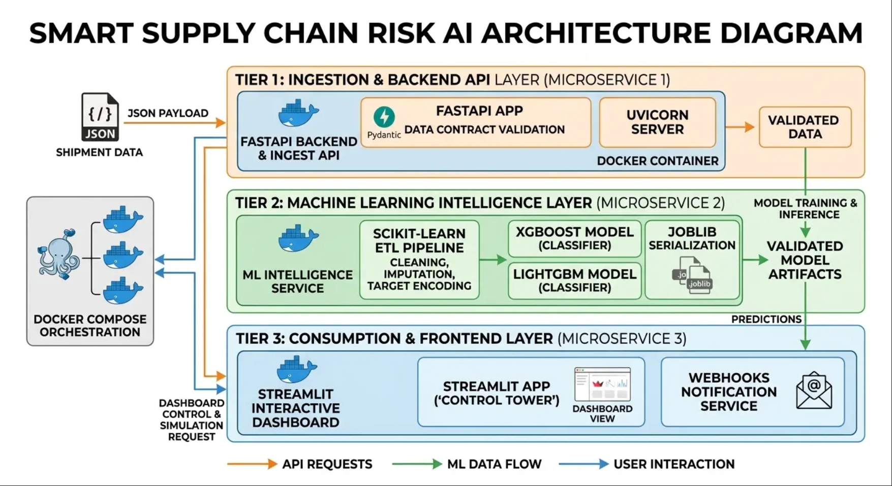

# Smart Supply Chain Risk AI

Torre de Control Inteligente de Logística y Cadena de Suministro B2B.

## Objetivo

Desarrollar un sistema que prediga el riesgo de retraso de un envío desde la creación del pedido. La solución ayudará a los ERP/WMS y a los gestores de tráfico a actuar antes del despacho mediante una API y un dashboard.

## Miembros

- Adrián Matemalas Manzanaro
- Raúl Romero Montoro
- Raúl Rincón Ortiz

## Organización del repositorio

- `docs/`: entregables y documentación.
- `data/`: datos del proyecto, separados en `raw/` (crudos) y `cleaned/` (limpios, generados); ambos directorios se ignoran por git.
- `environment/`: configuración para reproducir el entorno.
- `src/`: código de datos, modelo, API y dashboard.

El equipo trabaja con GitFlow: las tareas se desarrollan en ramas `feature/<tarea>`, se revisan mediante PR hacia `develop` y las entregas se integran en `main` con su correspondiente *tag*.

## Arquitectura resumida



## Estructura

```text
Grupo7-TFM-PlanetaFP/
├── data/
│   ├── raw/        # datos crudos, p. ej. DataCoSupplyChainDataset.csv (gitignored)
│   └── cleaned/    # datos limpios generados por el pipeline (gitignored)
├── docs/
├── environment/
├── src/
│   ├── api/
│   │   ├── main.py
│   │   ├── schemas.py
│   │   └── webhooks.py
│   ├── dashboard/
│   │   └── app.py
│   └── ml/
│       ├── config.yaml
│       ├── config.py
│       ├── model.py
│       ├── evaluate.py
│       ├── pipeline.py
│       └── train.py
├── tests/
├── environment/
│   ├── requirements.txt
│   ├── requirements-api.txt
│   ├── requirements-dashboard.txt
│   └── requirements-ml.txt
├── Dockerfile
├── docker-compose.yml
└── README.md
```

## API de ingesta y predicción

La API FastAPI expone:

- `GET /health`: comprobación de disponibilidad del servicio.
- `POST /ingest`: valida un envío y devuelve sus datos normalizados. Esta primera
  versión no persiste ni reenvía los registros.
- `POST /predict`: valida el mismo contrato de entrada que `/ingest`. Devuelve
  `503 Service Unavailable` hasta que se configure el artefacto del modelo; no
  genera predicciones simuladas.

El contrato inicial contiene solo atributos disponibles al crear el pedido y
excluye identificadores personales y variables de resultado que podrían causar
fuga de información. Es un contrato inicial y deberá alinearse con las features
finales del pipeline de entrenamiento.

### Contrato frente a DataCo

El dataset se obtiene de
[DataCo SMART SUPPLY CHAIN FOR BIG DATA ANALYSIS](https://www.kaggle.com/datasets/shashwatwork/dataco-smart-supply-chain-for-big-data-analysis).
La API se ha contrastado con `DataCoSupplyChainDataset.csv` (53 columnas,
180.519 filas y 65.752 pedidos distintos). Cada fila representa un artículo de
pedido; los pedidos tienen entre uno y cinco artículos en este dataset. Por eso,
la API recibe atributos comunes del pedido y una lista `order_items`. El CSV no
se incluye en el repositorio.

| Campo de API | Columna de DataCo |
| --- | --- |
| `order_date` | `order date (DateOrders)`; la API requiere fecha ISO 8601 |
| `shipping_mode` | `Shipping Mode` |
| `customer_segment` | `Customer Segment` |
| `market` | `Market` |
| `order_region` | `Order Region` |
| `order_items[].product_category_id` | `Product Category Id` |
| `order_items[].product_price` | `Order Item Product Price` |
| `order_items[].order_item_quantity` | `Order Item Quantity` |
| `order_items[].order_item_discount` | `Order Item Discount` |

La etiqueta objetivo es `Late_delivery_risk`, pero no se acepta como dato de
entrada. También se excluyen del contrato las variables posteriores al envío
(por ejemplo, `Days for shipping (real)`, `Delivery Status` y
`shipping date (DateOrders)`), además de datos personales y vinculables como
`Customer Email`, `Customer Fname`, `Customer Lname`, `Customer Password`,
`Customer Street`, `Customer Zipcode`, `Customer Id` y `Order Customer Id`.
El CSV crudo no se debe subir al repositorio; su ruta local está protegida en
`.gitignore`. En DataCo las filas de un mismo pedido comparten la etiqueta
`Late_delivery_risk`; el pipeline de ML debe confirmar si entrenará por artículo
o agregará las features por pedido antes de conectar el modelo a `/predict`.

### Alertas por webhook

El módulo `src.api.webhooks` ofrece `send_high_risk_alert`, que envía por HTTP
POST el JSON de la predicción cuando `Risk_Level` es `"Alto"`. La URL se
configura con `WEBHOOK_URL`; `WEBHOOK_MAX_ATTEMPTS` permite ajustar el número
de intentos (por defecto, 3). Se reintentan fallos de transporte y respuestas
transitorias HTTP 408, 429 y 5xx; otros errores HTTP se notifican al llamador.
El envío está desacoplado de `/predict` hasta que el modelo esté integrado y se
acuerde el contrato final de su respuesta.

Para ejecutar localmente desde la raíz del repositorio:

```powershell
python -m venv .venv
.\.venv\Scripts\Activate.ps1
python -m pip install -r environment\requirements.txt
uvicorn src.api.main:app --reload
```

La documentación interactiva está disponible en `http://127.0.0.1:8000/docs`.
Para ejecutar las pruebas: `python -m pytest`.
Para ejecutar el panel localmente, instala también
`environment\requirements-dashboard.txt` y usa
`streamlit run src\dashboard\app.py`.

### Ejecución con Docker

Docker Compose levanta la API y el panel Streamlit inicial. El panel comprueba
la disponibilidad de la API mediante la red interna de Compose; los datos
crudos y las pruebas se excluyen del contexto de construcción.

```powershell
docker compose up --build
```

La API queda disponible en `http://localhost:8000` y el dashboard en
`http://localhost:8501`. Compose espera a que la API supere su healthcheck antes
de iniciar el panel. Los puertos del host se pueden cambiar con las variables
`API_PORT` y `DASHBOARD_PORT`.

El Dockerfile define objetivos de construcción independientes (`api` y 
`dashboard`) sobre `python:3.10-slim`. El dashboard actual es la base de la Torre de Control: comprueba la salud de
la API y reserva las vistas de indicadores operativos, riesgo regional y envíos
recientes. Muestra estados vacíos explícitos en lugar de inventar predicciones.
La API actual solo valida la ingesta y `/predict` devuelve `503` mientras no
haya modelo; todavía no ofrece un histórico, agregados ni coordenadas para
alimentar esas vistas. El mapa y los indicadores se conectarán cuando estén
disponibles los datos y contratos correspondientes.

## Entrenamiento del modelo (XGBoost)

El código de entrenamiento vive en `src/ml`, separado de la API y del panel
porque tiene su propio conjunto de dependencias (`environment/requirements-ml.txt`)
y un ciclo de vida distinto (entrenamiento *offline* por lotes, no desplegable).
Se mantiene bajo `src/` para respetar la convención de paquetes `src.<módulo>`
(`src.api`, `src.dashboard`, `src.ml`). Los objetivos de construcción del
Dockerfile (`api`, `dashboard`) solo copian su subdirectorio, así que las
dependencias de ML nunca entran en las imágenes desplegables.

`src/ml` es **solo entrenamiento**: carga un fichero limpio a nivel de pedido,
entrena y guarda el artefacto. La carga, limpieza y agregación del CSV crudo
(`loader`, `target`, `features`) es responsabilidad del pipeline de datos.

**Contrato de entrada:** un fichero Parquet a nivel de pedido con una columna
por feature y la columna `Late_delivery_risk` (0/1). Su ruta se define en
`config.yaml` (`data.cleaned_path`, por defecto `data/cleaned/orders.parquet`).

Los datos se organizan en `data/raw/` (ficheros fuente, como el CSV de Kaggle)
y `data/cleaned/` (salida del pipeline de datos, regenerable). Ambos directorios
están ignorados por git y solo se conservan sus `.gitkeep`.

Objetivo: predecir la probabilidad de retraso de un envío. `XGBClassifier` con
`objective: binary:logistic` produce `P(retraso) ∈ [0,1]`. El porcentaje de
riesgo es `100 × P`, que es lo que `/predict` expondrá como `delay_probability`
(`delay_risk` se deriva con el umbral `model.threshold`, por defecto 0.5).

Estructura:

```text
src/ml/
├── config.yaml     # cleaned_path, hiperparámetros, split, umbral, rutas
├── config.py       # carga de config.yaml
├── model.py        # XGBClassifier: build/train/save + metadata
├── evaluate.py     # métricas y conversión probabilidad → porcentaje
├── pipeline.py     # load limpio → split → train → evaluate → save
└── train.py        # punto de entrada CLI
```

Para entrenar (requiere el fichero limpio en `data/cleaned/orders.parquet`):

```bash
pip install -r environment/requirements-ml.txt
python -m src.ml.train
```

El artefacto se guarda en `src/ml/artifacts/` (ignorado por git): el modelo
(`delay_risk_xgb.json`) y `model_metadata.json` con features, métricas, umbral y
parámetros. Cuando se integre el modelo en `/predict`, se carga desde ese
directorio.
